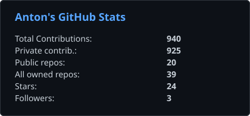
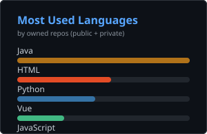
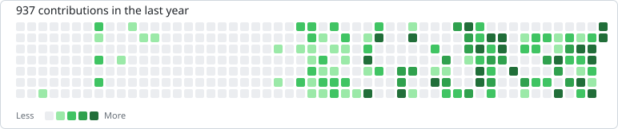

# Привет, я Антон

Backend · архитектура · system design

       

 

---

## Чем занимаюсь

- Разрабатываю высоконагруженные интеграции на Go и Java / Spring.
- Проектирую и разрабатываю backend на Go и Java / Spring: сервисы, API, модель данных, вывод в прод. Выношу куски из монолита в сервисы без простоя.
- Строю интеграции между системами: очереди, внешние API, ERP (1С), идемпотентность, outbox, DLQ, согласованность данных.
- Делаю так, чтобы инцидент искался по трейсу.
- Веду свой SaaS [Bulkhead CRM](https://bulkheadcrm.ru) — от схемы и контрактов до эксплуатации: мультитенантность, внешние CRM, SLO.

---

## 🏛️ Архитектура & Практика

Не занимаюсь оверхедом ради паттернов — подбираю архитектуру под задачу:

- **DDD & Clean / Hexagonal** — для доменов со сложной бизнес-логикой, где важно изолировать домен от инфраструктуры и сторонних API.
- **Vertical Slice** — для быстрых и изолированных фич без раздувания слоёв abstractions-over-abstractions.
- **Capability Core** — для продукта с несколькими каналами и поставщиками: стабильное ядро возможностей, вокруг — сменные адаптеры.
- **Интеграционные контуры** — проектирую межсервисное взаимодействие с учетом ненадёжности сети: transactional outbox, idempotency keys, DLQ, CDC, дедупликация на стороне consumer.
- **Observability** — выстраиваю сквозную трассировку (gRPC/Kafka context propagation) в OpenTelemetry, чтобы любой инцидент трекался от входа до SQL-запроса.

---

## Стек

  

gRPC / Protobuf · OpenTelemetry / Tempo / Loki · CI/CD (GitLab CI, GitHub Actions)

---

## Тестирование

Unit, integration, e2e, table-driven tests, моки через интерфейсы, sqlmock, race detector.

Отдельные тесты на инварианты интеграций: дедупликация, конфликты версий, изоляция тенанта.

---

## GitHub

  
  

  

